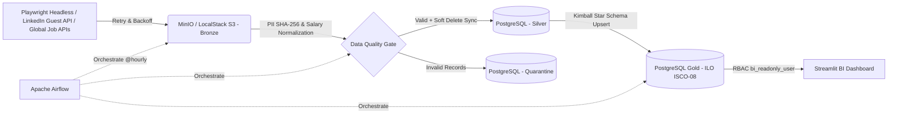

# End-to-End Job Market Data Pipeline (Medallion Architecture & ILO ISCO-08)

Hệ thống Data Pipeline tự động thu thập đa nguồn, làm sạch, kiểm định chất lượng (Data Quality Gate), quản lý vòng đời tin tuyển dụng (**Soft Delete**) và mô hình hóa dữ liệu thị trường lao động theo kiến trúc **Medallion (Bronze - Silver - Gold)** chuẩn phân loại nghề nghiệp quốc tế **ILO ISCO-08**, điều phối bởi **Apache Airflow** và đóng gói bằng **Docker**.

## 1. Kiến trúc Hệ thống (System Architecture)



* **Cơ chế Cào Đa nguồn (Multi-Source Ingestion):**
  * **Playwright Headless Chromium:** Vượt lớp kiểm tra bot và thu thập dữ liệu tuyển dụng tự động (kèm cơ chế tự động fallback sang HTTP Session có Retry/Backoff).
  * **LinkedIn Guest API & Cổng tuyển dụng nội địa (TopCV):** Quét dữ liệu việc làm thực tế tại thị trường Việt Nam không cần tài khoản đăng nhập.
  * **Global Job APIs (Remotive, Arbeitnow):** Đồng bộ dữ liệu việc làm quốc tế và phân loại tự động vào **10 Nhóm ngành chính của ILO (ISCO-08)**.
* **Tầng Bronze (Raw Data Lake - S3/MinIO):** Lưu trữ dữ liệu JSON nguyên bản theo phân vùng Hive-style (`raw_jobs/year=YYYY/month=MM/day=DD/`).
* **Tầng Silver (`silver.clean_jobs` & `quarantine.rejected_jobs`):**
  * Chuẩn hóa khoảng lương đa ngoại tệ (USD theo giờ/tháng/năm, VND) về đơn vị chuẩn `VND/tháng`.
  * **Bảo mật PII:** Băm một chiều `SHA-256` đối với email HR (`hr_email_sha256`) và che số điện thoại (`hr_phone_masked`).
  * **Data Quality Gate:** Tự động cách ly các bản ghi thiếu khóa chính, thiếu tên công ty/chức danh, số năm kinh nghiệm âm hoặc khoảng lương ngược logic (`min_salary_vnd > max_salary_vnd`) sang bảng `quarantine.rejected_jobs`.
  * **Soft Delete (`is_active` & `last_seen_at`):** Tự động đánh dấu `is_active = FALSE` cho các tin thuộc nguồn vừa quét nhưng không còn xuất hiện, và bật lại `is_active = TRUE` kèm `last_seen_at = CURRENT_TIMESTAMP` cho các tin còn tồn tại thông qua `INSERT ... ON CONFLICT (job_id) DO UPDATE`.
* **Tầng Gold (Star Schema Data Warehouse - Chuẩn ILO ISCO-08):**
  * Bảng Fact: `gold.fact_job_postings` (đồng bộ trạng thái `is_active`, `last_seen_at` từ tầng Silver).
  * Các bảng Dimension & Bridge: `gold.dim_occupation` (`UNIQUE (ilo_group_code, base_occupation)`), `gold.dim_company`, `gold.dim_location`, `gold.dim_date`, và `gold.bridge_job_skills (job_id, skill_name)`.
* **Bảo mật Phân quyền (RBAC Security):**
  * `airflow_etl_user`: Toàn quyền đọc/ghi trên cả 3 schemas (`silver`, `quarantine`, `gold`) phục vụ tiến trình ETL.
  * `bi_readonly_user`: Chỉ có quyền `SELECT` trên schema `gold` phục vụ Streamlit Dashboard / BI; bị `REVOKE ALL` hoàn toàn trên `silver` và `quarantine` để bảo vệ dữ liệu thô và PII.

## 2. Cấu trúc thư mục

```text
it-job-market-de-pipeline/
├── dags/
│   └── it_jobs_etl_dag.py           # Airflow DAG điều phối luồng chạy tự động
├── src/
│   ├── extract/
│   │   ├── ingest_to_bronze.py      # Cào dữ liệu Playwright/HTTP & đẩy lên Bronze S3
│   │   └── multi_source_scraper.py  # Quét đa nguồn (LinkedIn Guest API, TopCV, Global APIs)
│   ├── transform/
│   │   └── bronze_to_silver.py      # Chuẩn hóa lương, băm PII, Quarantine & Soft Delete
│   ├── load/
│   │   └── silver_to_gold.py        # Nạp Star Schema chuẩn ILO ISCO-08 (Idempotent Upsert)
│   └── dashboard.py                 # Streamlit BI Dashboard phân cấp 3 tầng chuẩn ILO
├── sql/
│   └── init_dw.sql                  # Khởi tạo Schemas, Tables & Phân quyền RBAC
├── tests/
│   └── test_transformations.py      # Unit tests kiểm thử băm PII, mask SĐT & chuẩn hóa lương
├── requirements.txt                 # Danh sách thư viện Python
└── docker-compose.yml               # Cấu hình hạ tầng Docker Compose
```

## 3. Hướng dẫn Khởi chạy & Kiểm thử

```bash
# 1. Khởi chạy toàn bộ cụm dịch vụ
docker compose up -d

# 2. Chạy Unit Tests kiểm định hàm xử lý dữ liệu
pytest -q
```
