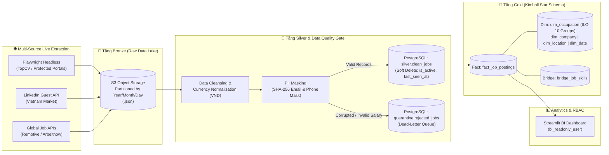
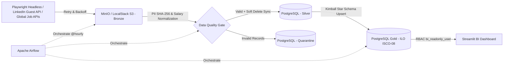

# 🏗️ End-to-End Multi-Industry Job Market Data Engineering Pipeline (ILO ISCO-08 Standard)


Hệ thống **Data Engineering Pipeline & Data Warehouse** tự động thu thập, kiểm định chất lượng, ẩn danh hóa dữ liệu nhạy cảm (PII) và phân tích thị trường lao động đa ngành theo tiêu chuẩn phân loại nghề nghiệp quốc tế **ILO (ISCO-08)** kết hợp kiến trúc **Medallion (Bronze - Silver - Gold)**.

---

## 📐 Kiến trúc Hệ thống (System Architecture)



---

## 🚀 Các Điểm Nhấn Kỹ Thuật (Key Engineering Highlights)

### 1. Thu thập Dữ liệu Đa nguồn & Vượt rào cản Anti-Bot (Multi-Source Live Ingestion)

- **Playwright Headless Chromium (`ingest_to_bronze.py` & `multi_source_scraper.py`):** Khởi chạy trình duyệt ẩn danh giả lập hành vi người dùng thật để thu thập dữ liệu từ các cổng việc làm có bảo mật Cloudflare/Bot Control.
- **LinkedIn Guest API & Global REST APIs:** Tích hợp luồng quét trực tiếp từ LinkedIn Việt Nam, Remotive và Arbeitnow với cơ chế `HTTPAdapter Retry` (Exponential Backoff) và tự động khởi tạo S3 Bucket (`Idempotent Bucket Creation`).
- **Data Lake Partitioning:** Lưu trữ dữ liệu thô nguyên bản (Immutable Raw JSON) trên S3 theo phân vùng thời gian `raw_jobs/year=YYYY/month=MM/day=DD/`.

### 2. Cổng Kiểm định Chất lượng & Bảo mật PII (Data Quality Gate & PII Masking)

- **Dead-Letter Quarantine (`quarantine.rejected_jobs`):** Tự động bóc tách và cô lập các bản ghi dị biệt (thiếu `job_id`, số năm kinh nghiệm âm, hoặc khoảng lương vô lý `min > max`) kèm mảng lý do lỗi `error_reasons` mà không làm gãy luồng ETL.
- **Bảo mật thông tin cá nhân (GDPR / PII Compliance):** Băm một chiều email tuyển dụng bằng thuật toán **SHA-256** (`hr_email_sha256`) và che giấu số điện thoại (`090****777`) ngay trước khi hạ cánh xuống tầng Silver.
- **Chuẩn hóa Tiền tệ:** Tự động nhận diện và quy đổi mức lương đa ngoại tệ (USD theo năm/tháng, triệu VNĐ) về đơn vị chuẩn `VND/tháng`.

### 3. Cơ chế Xóa mềm & Theo dõi Trạng thái Tin tuyển dụng (Soft Delete & Heartbeat)

- Giải quyết bài toán tin tuyển dụng bị gỡ bỏ trên nền tảng gốc bằng cờ trạng thái **`is_active`** và dấu thời gian **`last_seen_at`**.
- Khi một tin không còn xuất hiện trong phiên quét mới nhất của nguồn tương ứng, hệ thống tự động chuyển `is_active = FALSE` để ẩn khỏi Dashboard hiện tại nhưng vẫn **bảo toàn 100% lịch sử trong Fact Table** phục vụ phân tích xu hướng dài hạn.

### 4. Thiết kế Kho dữ liệu Star Schema chuẩn Quốc tế ILO (ISCO-08)

- **Bảng Sự kiện (`gold.fact_job_postings`):** Chứa các độ đo định lượng (`min_salary_vnd`, `max_salary_vnd`, `avg_salary_vnd`, `min_yoe`) và khóa ngoại.
- **Bảng Chiều Nghề nghiệp (`gold.dim_occupation`):** Chuẩn hóa theo 10 Nhóm ngành lớn của Tổ chức Lao động Quốc tế (ILO ISCO-08) và nghề cơ bản (`base_occupation`).
- **Xử lý quan hệ Nhiều-Nhiều (`gold.bridge_job_skills`):** Tách mảng kỹ năng JSONB thành bảng cầu nối chuẩn hóa giúp truy vấn Top Skills tốc độ cao mà không bị trùng lặp (fan-out) tổng lương.

### 5. Phân quyền Truy cập Nghiêm ngặt (Role-Based Access Control - RBAC)

- **`airflow_etl_user`:** Toàn quyền đọc/ghi trên các tầng `silver`, `quarantine`, `gold`.
- **`bi_readonly_user`:** Tài khoản kết nối từ Streamlit Dashboard — chỉ có quyền `SELECT` duy nhất trên tầng `gold`, bị thu hồi hoàn toàn quyền truy cập (`REVOKE ALL`) vào tầng `silver` và `quarantine`.

---

## 📁 Cấu trúc Thư mục (Repository Structure)

```text
it-job-market-de-pipeline/
├── dags/
│   └── it_jobs_etl_dag.py          # Airflow DAG lập lịch tự động (@hourly)
├── sql/
│   └── init_dw.sql                 # Khởi tạo Schemas, Star Schema Tables & Phân quyền RBAC
├── src/
│   ├── extract/
│   │   ├── ingest_to_bronze.py     # Playwright Headless & API Ingestion đẩy vào S3 Bronze
│   │   └── multi_source_scraper.py # Bộ thu thập mở rộng (LinkedIn VN + TopCV + Global)
│   ├── transform/
│   │   └── bronze_to_silver.py     # Làm sạch, SHA-256 PII, Quality Gate & Soft Delete
│   ├── load/
│   │   └── silver_to_gold.py       # Nạp dữ liệu Incremental Upsert vào mô hình Star Schema
│   └── dashboard.py                # Giao diện BI phân tích đa chiều (Streamlit)
├── tests/
│   └── test_transformations.py     # Unit Tests kiểm thử logic ETL với Pytest
├── docker-compose.yml              # Hạ tầng контейнера: Postgres, S3, Airflow, Streamlit
├── requirements.txt                # Danh sách thư viện Python
└── .env.example                    # Mẫu cấu hình biến môi trường
```

---

## ⚡ Hướng dẫn Khởi chạy Nhanh (Quick Start)

### Bước 1: Khởi chạy Hạ tầng Docker

```powershell
cp .env.example .env
docker compose up -d
```

### Bước 2: Chạy Luồng ETL (Từ Container hoặc Airflow UI tại `http://localhost:8080`)

```powershell
docker exec -it de_airflow_scheduler python /opt/airflow/src/extract/ingest_to_bronze.py
docker exec -it de_airflow_scheduler python /opt/airflow/src/transform/bronze_to_silver.py
docker exec -it de_airflow_scheduler python /opt/airflow/src/load/silver_to_gold.py
```

*(Tùy chọn) Quét trực tiếp trình duyệt đa nguồn LinkedIn VN + TopCV từ máy Host:*

```powershell
py src/extract/multi_source_scraper.py
```

### Bước 3: Kiểm thử Tự động (Unit Testing) & Truy cập Dashboard

```powershell
pytest tests/test_transformations.py -v
```

- **BI Dashboard:** Truy cập `http://localhost:8501` (sử dụng kết nối bảo mật `bi_readonly_user`).
- **Airflow Webserver:** Truy cập `http://localhost:8080` (User/Pass: `admin` / `admin`

# End-to-End Job Market Data Pipeline (Medallion Architecture & ILO ISCO-08)

Hệ thống Data Pipeline tự động thu thập đa nguồn, làm sạch, kiểm định chất lượng (Data Quality Gate), quản lý vòng đời tin tuyển dụng (**Soft Delete**) và mô hình hóa dữ liệu thị trường lao động theo kiến trúc **Medallion (Bronze - Silver - Gold)** chuẩn phân loại nghề nghiệp quốc tế **ILO ISCO-08**, điều phối bởi **Apache Airflow** và đóng gói bằng **Docker**.

## 1. Kiến trúc Hệ thống (System Architecture)



* **Cơ chế Cào Đa nguồn (Multi-Source Ingestion):**
  * **Playwright Headless Chromium:** Vượt lớp kiểm tra bot và thu thập dữ liệu tuyển dụng tự động (kèm cơ chế tự động fallback sang HTTP Session có Retry/Backoff).
  * **LinkedIn Guest API & Cổng tuyển dụng nội địa (TopCV):** Quét dữ liệu việc làm thực tế tại thị trường Việt Nam không cần tài khoản đăng nhập.
  * **Global Job APIs (Remotive, Arbeitnow):** Đồng bộ dữ liệu việc làm quốc tế và phân loại tự động vào **10 Nhóm ngành chính của ILO (ISCO-08)**.
* **Tầng Bronze (Raw Data Lake - S3/MinIO):** Lưu trữ dữ liệu JSON nguyên bản theo phân vùng Hive-style (`raw_jobs/year=YYYY/month=MM/day=DD/`).
* **Tầng Silver (`silver.clean_jobs` & `quarantine.rejected_jobs`):**
  * Chuẩn hóa khoảng lương đa ngoại tệ (USD theo giờ/tháng/năm, VND) về đơn vị chuẩn `VND/tháng`.
  * **Bảo mật PII:** Băm một chiều `SHA-256` đối với email HR (`hr_email_sha256`) và che số điện thoại (`hr_phone_masked`).
  * **Data Quality Gate:** Tự động cách ly các bản ghi thiếu khóa chính, thiếu tên công ty/chức danh, số năm kinh nghiệm âm hoặc khoảng lương ngược logic (`min_salary_vnd > max_salary_vnd`) sang bảng `quarantine.rejected_jobs`.
  * **Soft Delete (`is_active` & `last_seen_at`):** Tự động đánh dấu `is_active = FALSE` cho các tin thuộc nguồn vừa quét nhưng không còn xuất hiện, và bật lại `is_active = TRUE` kèm `last_seen_at = CURRENT_TIMESTAMP` cho các tin còn tồn tại thông qua `INSERT ... ON CONFLICT (job_id) DO UPDATE`.
* **Tầng Gold (Star Schema Data Warehouse - Chuẩn ILO ISCO-08):**
  * Bảng Fact: `gold.fact_job_postings` (đồng bộ trạng thái `is_active`, `last_seen_at` từ tầng Silver).
  * Các bảng Dimension & Bridge: `gold.dim_occupation` (`UNIQUE (ilo_group_code, base_occupation)`), `gold.dim_company`, `gold.dim_location`, `gold.dim_date`, và `gold.bridge_job_skills (job_id, skill_name)`.
* **Bảo mật Phân quyền (RBAC Security):**
  * `airflow_etl_user`: Toàn quyền đọc/ghi trên cả 3 schemas (`silver`, `quarantine`, `gold`) phục vụ tiến trình ETL.
  * `bi_readonly_user`: Chỉ có quyền `SELECT` trên schema `gold` phục vụ Streamlit Dashboard / BI; bị `REVOKE ALL` hoàn toàn trên `silver` và `quarantine` để bảo vệ dữ liệu thô và PII.

## 2. Cấu trúc thư mục

```text
it-job-market-de-pipeline/
├── dags/
│   └── it_jobs_etl_dag.py           # Airflow DAG điều phối luồng chạy tự động
├── src/
│   ├── extract/
│   │   ├── ingest_to_bronze.py      # Cào dữ liệu Playwright/HTTP & đẩy lên Bronze S3
│   │   └── multi_source_scraper.py  # Quét đa nguồn (LinkedIn Guest API, TopCV, Global APIs)
│   ├── transform/
│   │   └── bronze_to_silver.py      # Chuẩn hóa lương, băm PII, Quarantine & Soft Delete
│   ├── load/
│   │   └── silver_to_gold.py        # Nạp Star Schema chuẩn ILO ISCO-08 (Idempotent Upsert)
│   └── dashboard.py                 # Streamlit BI Dashboard phân cấp 3 tầng chuẩn ILO
├── sql/
│   └── init_dw.sql                  # Khởi tạo Schemas, Tables & Phân quyền RBAC
├── tests/
│   └── test_transformations.py      # Unit tests kiểm thử băm PII, mask SĐT & chuẩn hóa lương
├── requirements.txt                 # Danh sách thư viện Python
└── docker-compose.yml               # Cấu hình hạ tầng Docker Compose
```

## 3. Hướng dẫn Khởi chạy & Kiểm thử

```bash
# 1. Khởi chạy toàn bộ cụm dịch vụ
docker compose up -d

# 2. Chạy Unit Tests kiểm định hàm xử lý dữ liệu
pytest -q
```
