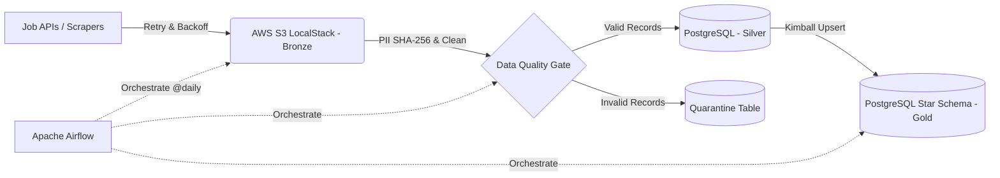

# End-to-End IT Job Market Data Pipeline (Medallion Architecture)

Hệ thống Data Pipeline tự động thu thập, làm sạch, kiểm định chất lượng và mô hình hóa dữ liệu thị trường tuyển dụng IT theo kiến trúc **Medallion (Bronze - Silver - Gold)**, điều phối bởi **Apache Airflow** và đóng gói hoàn toàn bằng **Docker**.

## 1. Kiến trúc Hệ thống (System Architecture)

* **Tầng Bronze (Raw Data Lake):** Lưu trữ dữ liệu JSON nguyên bản trên **AWS S3 (LocalStack)** theo phân vùng Hive-style (`year=YYYY/month=MM/day=DD`).
* **Tầng Silver (Cleaned & Validated):**
  * Chuẩn hóa khoảng lương về đơn vị VND.
  * **Bảo mật PII:** Băm một chiều `SHA-256` email HR và che dấu (masking) số điện thoại.
  * **Data Quality Gate:** Tự động cách ly các bản ghi thiếu khóa chính hoặc sai lệch logic lương sang bảng `quarantine.rejected_jobs`.
* **Tầng Gold (Star Schema Data Warehouse):** Mô hình hóa theo chuẩn Kimball gồm bảng Fact (`fact_job_postings`) và các bảng Dimension (`dim_company`,
  `dim_location`,`dim_date`), nạp dữ liệu theo cơ chế  **Incremental Upsert (Idempotent)** .

# 2. Công nghệ sử dụng (Tech Stack)

*    Ngôn ngữ: Python 3.11, SQL
* Điều phối (Orchestration): Apache Airflow 2.9 (LocalExecutor)

* Data Lake (Object Storage): AWS S3 (via LocalStack) & boto3
* Data Warehouse: PostgreSQL 15
* Hạ tầng & Bảo mật: Docker Compose, RBAC (tách biệt quyền airflow_etl_user và bi_readonly_user), quản lý khóa bằng Fernet Key & .env.

# 3. Cấu trúc thư mục

it-job-market-de-pipeline/
├── dags/
│   └── it_jobs_etl_dag.py        # Airflow DAG điều phối luồng chạy hàng ngày
├── src/
│   ├── extract/
│   │   └── ingest_to_bronze.py   # Thu thập dữ liệu (Retry/Backoff) & đẩy lên S3
│   ├── transform/
│   │   └── bronze_to_silver.py   # Chuẩn hóa, băm SHA-256 PII & lọc Quarantine
│   └── load/
│       └── silver_to_gold.py     # Nạp dữ liệu vào Star Schema (Upsert)
├── sql/
│   └── init_dw.sql               # Khởi tạo Schema & Phân quyền RBAC
└── docker-compose.yml            # Cấu hình hạ tầng контейнеров

# 4. Hướng dẫn cài đặt và khởi chạy (Quick Start)

### 1. Khởi chạy toàn bộ cụm dịch vụ: 	docker compose up -d

### 2. Khởi tạo S3 Bucket cho tầng Bronze: 	docker exec -it de_s3_localstack awslocal s3 mb s3://bronze-it-jobs

### 3. Truy cập **Airflow Web UI** tại `http://localhost:8080` và kích hoạt DAG `it_jobs_market_etl_pipeline`.
